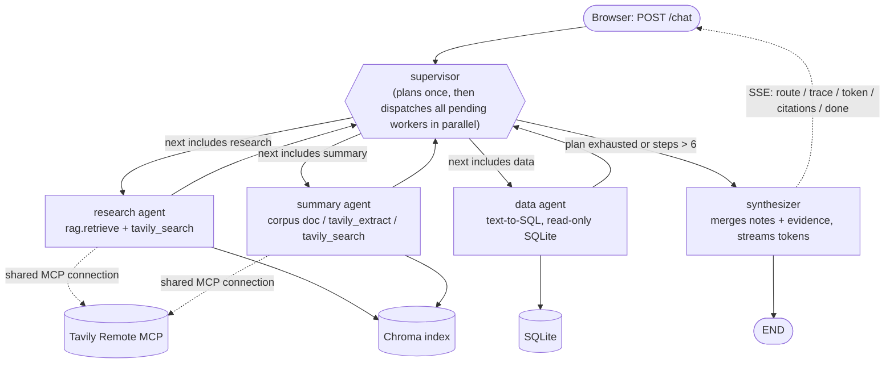

# Architecture

Multi-agent RAG system: a LangGraph **supervisor** pattern with three specialised workers (research, summary, data), a final-answer synthesizer, a RAG pipeline over 40 research papers, a shared Tavily Remote MCP connection, and routing across **NVIDIA NIM (cheap tier)** and **OpenAI (strong tier)**. The whole backend is one file, `app.py` (FastAPI + SSE + LangGraph); the frontend is a single vanilla HTML/JS page served by the same app at `/`.

## 1. Orchestration graph



Edges are defined in `build_graph()`: `START → supervisor`, a conditional edge from the supervisor driven by `state["next"]`, `worker → supervisor` for every worker, and `synthesizer → END`. Nothing is hard-coded per query: the supervisor classifies the query with an LLM (falling back to a regex heuristic plan if the call or its JSON fails), writes the plan into state, and on every visit sends **all** unfinished workers in `state["plan"]` at once: `state["next"]` is a list, and LangGraph runs the listed workers in parallel in one step, then returns to the supervisor once they have all finished. Workers do not depend on each other (the data agent's handoff to research adds research to the plan, and the supervisor dispatches it on the next visit). `MAX_STEPS = 6` bounds the loop. Parallel dispatch cut the worker phase of a three-agent question (summary, research, data) from 19 s to 14 s, and the mixed news + ReAct question from 41 s to 22 s in total; the run now takes as long as its slowest worker, not the sum.

**Citation labels under parallel dispatch.** Workers started together cannot see each other's citations, so each starts its labels in its own block (`slots`, `LABEL_BLOCK`: C 40, W 10, S 5 apart) and every citation is tagged with the agent that made it. The synthesizer then puts the citations in plan order, numbers each kind 1..n, and rewrites the labels inside the agents' notes to match, so the answer and the Citations tab show `C1, C2, W1, S1…` with no gaps.

### State schema (`class State(TypedDict)`)

| Field | Type | Reducer | Purpose |
|---|---|---|---|
| `query`, `history` | `str`, `list[dict]` | overwrite | input; history is sent by the browser (stateless server) |
| `planned`, `plan`, `needs_corpus`, `needs_live`, `complexity`, `plan_reason` | bool / list / bool / bool / `simple\|complex` / str | overwrite | the supervisor's inspectable routing decision |
| `next`, `slots`, `steps` | `list[str]`, `dict[str,int]`, int | overwrite | workers to run now (several = in parallel) and each one's citation-label block; loop counter |
| `completed` | `list[str]` | `operator.add` | workers that finished (success or failure) |
| `agent_outputs` | `dict[str, Any]` | `merge_dicts` | each worker's notes, keyed by agent |
| `citations` | `list[dict]` | `operator.add` | `[C#]` corpus chunks, `[W#]` web results, `[S#]` SQL queries |
| `routing` | `list[dict]` | `operator.add` | every provider decision: stage, provider, model, dimension, reason, agent |
| `errors` | `list[dict]` | `operator.add` | worker failures (the graph keeps going) |
| `trace` | `list[dict]` | `operator.add` | orchestration events shown in the UI trace panel |
| `answer` | str | overwrite | final text |

List/dict fields use reducers so parallel workers append instead of overwriting each other.

## 2. Agents: responsibilities, tools, prompts, providers

Specialisation is by **distinct tools and distinct system prompts**, not labels. An agent is a graph node (a prompt, a set of tools and its own state updates); the LLM is only the engine the node calls, and several nodes may share one model. The supervisor and the research agent are therefore different agents even when the router sends both of their LLM calls to the same cheap NVIDIA model: the supervisor only plans (no tools, JSON out), while research retrieves from Chroma and Tavily and writes cited notes.

| Agent | Tools | System prompt (summary) | Provider for its LLM step |
|---|---|---|---|
| **Supervisor** | none (planner) | `CLASSIFY_SYSTEM`: choose the fewest agents, set `needs_corpus`, `needs_live`, `complexity`, one-line reason; JSON only | cheap (NVIDIA) |
| **Research** | `rag.retrieve` (Chroma, hybrid dense + BM25, k=8), `tavily_search` (MCP) | `RESEARCH_SYSTEM`: write notes using only labelled evidence, cite `[C#]`/`[W#]` after every claim, never invent labels, state what is missing | cheap (NVIDIA) |
| **Summary** | corpus document reader (finds the paper by file name, arXiv id or paper name such as "the Self-RAG paper"; all its chunks, evenly down-sampled to 24), `tavily_extract` for URLs, `tavily_search` as fallback | `SUMMARY_SYSTEM`: summarise in reading order, preserve citation labels, add no facts | cheap (NVIDIA) |
| **Data** | `sqlite.describe_schema`, `sqlite.run_select` (read-only connection, `PRAGMA query_only`, single SELECT/WITH that must read FROM a table, forbidden-keyword filter, one retry with the error fed back); if the database cannot answer (`NO_SQL` or a constant SELECT) it hands the question to research by adding it to the plan in state | `SQL_SYSTEM` to write the query, `DATA_ANSWER_SYSTEM` to state the result and cite `[S#]` | strong (OpenAI): exact SQL matters |
| **Synthesizer** | none | `SYNTH_SYSTEM`: ground every claim in evidence, cite labels exactly as given, admit gaps and failed agents, no invented facts | routed per query (table below) |

The SQLite database (`data/sample.db`) is built by `ingest` and holds a `documents` table (one row per paper with title, source and chunk count), so the data agent answers corpus-statistics questions such as "how many chunks does each document have?".

## 3. LLM routing

Providers: **NVIDIA NIM** `nvidia/nemotron-3.5-lightning-30b-a3b` (free/low-cost, thinking disabled for speed), **OpenAI** `gpt-5.6-sol` (strong tier; the same account provides the `text-embedding-3-small` embeddings; the RAGAS judge is `gpt-5.1`, pinned separately with `JUDGE_MODEL` so scores stay comparable across runs). Anthropic `claude-sonnet-5-5` is supported as an optional extra provider but is not configured. Hybrid routing: cost for structured/short steps, capability for synthesis.

| Step | Rule (in `app.py`) | Dimension | Provider |
|---|---|---|---|
| Query classification | always a short structured task (`route_cheap`) | cost | NVIDIA |
| Research and summary LLM steps (notes, summary) | condensing retrieved material (`route_cheap`) | cost | NVIDIA |
| Data agent LLM steps (SQL, result sentence) | a wrong column or join gives a wrong number (`route_strong`) | capability | OpenAI |
| Final answer, short lookup | one agent, little evidence (at most 6,000 characters), classifier said `simple` (short data answers such as a top 3, short web results) | cost | NVIDIA |
| Final answer, grounded or complex | classifier said `complex`, **or** 2+ agents contributed, **or** evidence > 6,000 chars (`COMPLEX_CONTEXT_CHARS`; any answer built on a full set of 8 retrieved chunks crosses it), **or** a SQL result of more than 10 rows that must be reproduced in full (`SQL_ROWS_STRONG`; the cheap model shortened such tables) | capability | OpenAI |
| Any step, provider errors or times out (25 s without output) | fail over to another configured provider | fallback | the next configured provider; each remaining provider is tried in turn |
| Provider not configured | `_resolve()` substitutes the other tier | fallback | whichever is configured |

Every decision is emitted as an SSE `route` event and shown in the UI (agent, provider, model, dimension, reason) and in the trace log. `FORCE_SYNTH_PROVIDER` bypasses the synthesis rule for evaluation runs only.

## 4. RAG pipeline

1. **Corpus**: 40 arXiv papers (≈900 pages, listed in `scripts/corpus_manifest.md`) on RAG, LLM agents, tool use, multi-agent systems and RAG evaluation. `scripts/fetch_corpus.sh` re-downloads them.
2. **Ingestion** (`python app.py ingest`): `pypdf` extracts text per page; `normalize_pdf_text` removes hyphenated line breaks and rebuilds running text (PDF extraction emits one newline per visual line); `chunk_document` then splits the whole document on sentence boundaries into chunks of up to **1000 characters with about 150 overlap**, so a passage that crosses a page break stays together, and folds any piece under 200 characters into its neighbour (no fragments); each chunk keeps `source`, `title`, `page` (where it starts), `chunk_index`. `.md`/`.txt` files keep the paragraph-based splitter. The human-readable `title` comes from `corpus/titles.json` (falling back to the PDF metadata, then the file name). Result: 6,114 chunks (median 929 characters, none under 200).
3. **Embedding + storage**: OpenAI `text-embedding-3-small` into an embedded **Chroma** collection (`hnsw:space=cosine`), persisted in `./chroma_index` and baked read-only into the container image. Each chunk is embedded with its paper title as a header (the stored text is unchanged), so a query that names a paper matches that paper's chunks.
4. **Retrieval** (hybrid): the top 30 chunks by cosine similarity and the top 30 by BM25 (over title + text, built in memory from the collection at first use) are merged with reciprocal rank fusion (`1/(60+rank)`), and the top **k = 8** are returned. `score` shown in the trace is the cosine similarity. `RAG_HYBRID=0` switches back to dense-only. **Paper focus:** if the query names a corpus paper (its title before the colon, an acronym in parentheses or before " - ", or any of those with "Retrieval-Augmented Generation" shortened to "RAG", e.g. "Tree of Thoughts", "Ragas", "Corrective RAG"), the 12 best chunks of that paper are added as a third ranked list to the fusion, so a question that also mentions another paper's topic ("…generalize chain-of-thought prompting") is not crowded out by that other paper. `RAG_PAPER_FOCUS=0` disables it.
5. **Augmentation**: each retrieved chunk becomes an evidence block, truncated to 1,200 characters, and the research agent receives (up to 8 evidence blocks):

```
System: <RESEARCH_SYSTEM>  (answer using ONLY the evidence; cite [C#]/[W#] after each claim;
        never invent a label; say exactly what is missing)
User:   Question: <query>

        Evidence:
        [C1] (<source>.pdf, p.<page>)
        <chunk text ...>

        [C2] (...)
        ...
        [W1] (<url>)
        <web snippet ...>
```

6. **Generation with citations**: the synthesizer receives the agents' notes plus the evidence blocks (at most 12) and writes the answer; `[C#]` chips in the UI open the exact source chunk through `GET /api/chunk/{id}`.

## 5. MCP tool sharing (rubric item 7)

One `TavilyHub` holds a single `langchain-mcp-adapters` connection to `https://mcp.tavily.com/mcp/?tavilyApiKey=…` (Streamable HTTP). Both the **research** agent (current-events grounding for a question) and the **summary** agent (`tavily_extract` for a URL, `tavily_search` when asked to summarise "the latest…") call the *same* `tavily_search` tool in different contexts. Every call is logged with the calling agent in `GET /api/config → mcp_call_log`, e.g. `{agent: research, tool: tavily_search}` and `{agent: summary, tool: tavily_search}`. When the part of a request being summarized asks for news ("Summarize the latest news about AI agents and compare it with … ReAct"), the summary agent searches the web even if a paper is named later in the question; the research agent covers the paper. Before this rule the summary agent took the named paper, so on that query only one agent called Tavily. A Tavily rate-limit reply (HTTP 429) is retried twice (after 3 s, then 6 s), for both search and extract. Rationale: one connection and one rate budget instead of per-agent clients, and the shared log proves the sharing. Tavily returns JSON (`{"results": [{url, title, content}]}`); each result becomes its own `[W#]` citation with title, URL and text, and `tavily_extract` output is reduced to the page text. Time-sensitive questions ("this week", "this month", "latest", "news", "today") are sent to Tavily's news index with a matching `time_range` (day, week or month); if that window returns nothing, the search is repeated on the general index. A plain search for "AI agent news this week" had returned evergreen help pages. The planner, research, summary and final-answer prompts end with today's date, because the models otherwise guess the date from their training data. The date is the user's own calendar date: the page sends its local date (`today`, `YYYY-MM-DD`) with each question, and the server accepts it only if it is a real date within a day of UTC today, otherwise it uses UTC. Without this, a US user testing in the evening was told tomorrow's date once UTC rolled over (one answer called October "August 2026"). Tavily failures that arrive as ordinary tool text (such as a 401 for a bad key) are converted to errors so they are never cited as evidence.

## 6. Failure handling

- A worker exception is caught by `safe_worker`, recorded in `state["errors"]`, and the supervisor continues; the synthesizer tells the user which agent failed.
- Every LLM call has a 25 s no-output deadline (the provider SDK timeouts were not reliable), and a failed worker or synthesis call fails over to another provider and emits a `reset` event so the UI discards partial tokens.
- Time limits at every step: 25 s without output for an LLM call or a Tavily call, 60 s for a whole worker LLM call (`LLM_WORKER_TOTAL_SECONDS`; then failover), NVIDIA research/summary notes capped at 1,200 output tokens, 15 s for the query embedding (then keyword-only retrieval), 45 s for the whole retrieval step, and 240 s for the whole question (`RUN_DEADLINE_S`, below Cloud Run's 300 s). When the last one is hit the stream sends an `error` event and then `done`, so the UI never hangs. Worker LLM calls are not streamed to the browser, so the trace prints "<agent> still working (10s)" every 10 s while one runs.
- Citation labels are checked against this turn's evidence: labels are stripped from the conversation history before it reaches any prompt, the final-answer prompt says history is context only, and any `[X#]` in the answer that has no matching citation is removed (the trace logs a warning and the answer is resent clean). Found when a URL summary cited `C4`, `S1` and `U1` from an earlier turn.
- The plan always includes the summary agent when the request asks for a summary, even if the classifier left it out.
- The plan also adds the summary agent when a comparison has live news on one side ("Compare the latest AI agent news with what the ReAct paper proposed"): the summary agent gathers the news through Tavily, the research agent reads the paper, and the two run in parallel. A classifier that picks one research agent for this would still answer, but only one agent would use the shared MCP connection.
- Earlier turns reach the classifier and the final-answer prompt only when the new question is a follow-up (a short question, or one using words like "it", "they", "again"). A self-contained question or a URL is answered without them, and the history is labelled as context for resolving references, so a previous answer cannot be repeated inside the new one.
- A follow-up is rewritten before planning (`resolve_followup`, one cheap NVIDIA call, shown in the Routing panel as `rewrite`): "What were its top-5 skill-retrieval accuracy numbers again?" becomes "What were Voyager's top-5 skill-retrieval accuracy numbers again?" and the agents retrieve and search with the rewritten question (`search_query` in the state). Before this, only the final-answer step saw the conversation, so the retriever matched DPR's top-k tables and the answer was about DPR. The final-answer prompt also gets the resolved meaning. If the rewrite fails or changes nothing, the question is used as asked.
- Tavily failure degrades to corpus-only evidence, or an honest "could not retrieve" answer.
- Verified by injection tests: bad Tavily key, bad NVIDIA key (everything fails over to OpenAI), missing SQLite file; each still ended with a `done` event and an answer.

## 7. State and deployment

The server is **stateless**: the browser sends the last turns with each request, so no durable store is needed or claimed. Cloud Run may recycle instances freely. The Chroma index and SQLite file are read-only artifacts baked into the image. API keys come from Secret Manager (`--set-secrets`); all text sent to the browser or logs passes through `scrub()`, which redacts the values of any `*KEY/TOKEN/SECRET/PASSWORD` environment variable and key-shaped strings (`sk-…`, `AIza…`, `tvly-…`, `nvapi-…`, `tavilyApiKey=…`, `Bearer …`).
